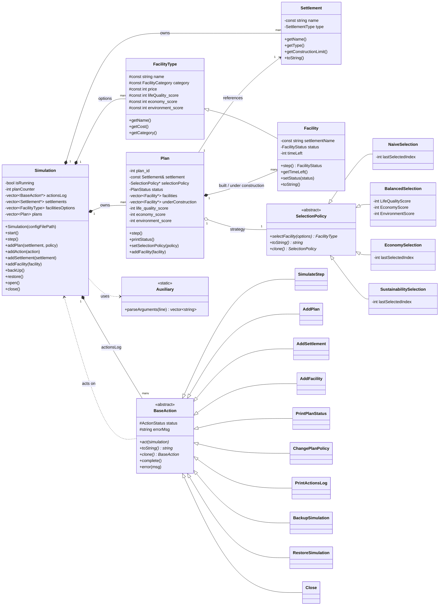
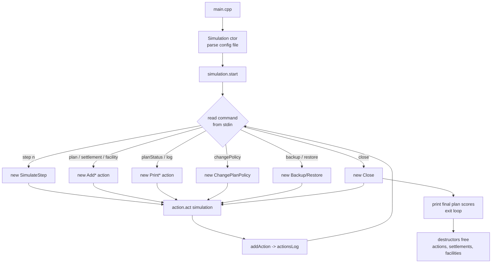

# SPL Assignment 1 — Simulation

A command-driven simulation of settlement development, written in C++11.
The program loads an initial world from a configuration file, then accepts
interactive commands that create settlements, facilities and development
plans, advance time, and report state.

---

## Table of Contents

- [Overview](#overview)
- [Design](#design)
  - [Class Diagram](#class-diagram)
  - [Action Flow](#action-flow)
  - [Module Responsibilities](#module-responsibilities)
- [Build](#build)
- [Run](#run)
- [Configuration File Format](#configuration-file-format)
- [Command Reference](#command-reference)
- [Example Session](#example-session)
- [Project Structure](#project-structure)
- [Memory Safety](#memory-safety)

---

## Overview

The simulation manages a set of **settlements**. Each settlement can have a
**plan** attached to it. A plan repeatedly chooses **facilities** to build
according to a **selection policy**, subject to the settlement's construction
limit. Each `step` advances construction by one time unit; when a facility's
remaining build time reaches zero it becomes operational and its
life-quality / economy / environment scores are added to the plan.

Every user command is reified as a `BaseAction` object and appended to an
actions log, which makes the whole session replayable and printable.

---

## Design

### Class Diagram



### Action Flow



**Inside a single `step`:** for every plan — while the number of facilities
under construction is below the settlement's construction limit, ask the
selection policy for the next facility and start building it; then decrement
`timeLeft` on each facility under construction and promote the finished ones
to `OPERATIONAL`, adding their scores to the plan.

### Module Responsibilities

| Module | Responsibility |
|---|---|
| `Simulation` | Owns the world; parses config, runs the command loop, owns backup/restore |
| `Settlement` | Name + type; derives the construction limit (village 1, city 2, metropolis 3) |
| `Plan` | Binds a settlement to a selection policy; drives construction and accumulates scores |
| `FacilityType` / `Facility` | Immutable blueprint vs. a concrete instance with status and remaining time |
| `SelectionPolicy` | Strategy interface — decides which facility to build next |
| `BaseAction` + subclasses | Command pattern — each user instruction is an object with `act` / `toString` / `clone` |
| `Auxiliary` | Static helper for whitespace tokenization of input lines |

**Patterns used:** Strategy (`SelectionPolicy`), Command (`BaseAction`),
Prototype (`clone()` on policies and actions, used by backup/restore),
Rule of 5 on `Simulation` for deep copy semantics.

---

## Build

Requirements: `g++` with C++11 support, `make`.

```bash
make
```

This runs `clean` then `link`, creating `bin/` automatically and producing
the executable at `bin/simulation`.

Other targets:

```bash
make compile   # compile object files only
make clean     # remove the bin directory
```

---

## Run

```bash
./bin/simulation <config_path>
```

For example, using the bundled configuration:

```bash
./bin/simulation config/config_full.txt
```

The program prints `The simulation has started`, then shows a `>` prompt and
reads commands from standard input until `close`.

You can also pipe a script of commands:

```bash
printf 'step 3\nplanStatus 0\nlog\nclose\n' | ./bin/simulation config/config_full.txt
```

---

## Configuration File Format

Plain text, one directive per line. Blank lines and lines starting with `#`
are ignored.

```text
settlement <name> <type>
facility    <name> <category> <price> <lifeq_score> <eco_score> <env_score>
plan        <settlement_name> <selection_policy>
```

| Field | Values |
|---|---|
| `type` | `0` village, `1` city, `2` metropolis |
| `category` | `0` life quality, `1` economy, `2` environment |
| `selection_policy` | `nve` naive, `bal` balanced, `eco` economy, `env` sustainability |

Settlements must be declared before the plans that reference them.

Example (`config/config_full.txt`):

```text
settlement KfarSPL 0
settlement TelSPL 1
settlement SPLCity 2

facility Hospital 0 5 3 1 0
facility Park     2 3 2 0 4
facility Factory  1 4 0 5 0

plan KfarSPL nve
plan TelSPL  bal
plan SPLCity eco
```

---

## Command Reference

| Command | Description |
|---|---|
| `step <n>` | Advance the simulation by `n` time units |
| `plan <settlement_name> <policy>` | Add a plan to an existing settlement |
| `settlement <name> <type>` | Add a new settlement |
| `facility <name> <category> <price> <lifeq> <eco> <env>` | Add a facility option |
| `planStatus <plan_id>` | Print a plan's scores and facilities |
| `changePolicy <plan_id> <policy>` | Replace a plan's selection policy |
| `log` | Print every action performed, with COMPLETED / ERROR status |
| `backup` | Snapshot the full simulation state |
| `restore` | Restore the last snapshot |
| `close` | Print final scores for all plans and exit |

Invalid commands and arguments are reported as `Error: <reason>` and recorded
in the log with `ERROR` status; the simulation keeps running.

---

## Example Session

```text
$ ./bin/simulation config/config_full.txt
The simulation has started
> step 3
> planStatus 0
PlanID: 0
SettlementName: KfarSPL
PlanStatus: BUSY
SelectionPolicy: nve
LifeQualityScore: 3
EconomyScore: 1
EnvironmentScore: 0
FacilityName: Hospital
FacilityStatus: OPERATIONAL
> changePolicy 0 env
PlanID: 0
previousPolicy: nve
newPolicy: env
> backup
> step 5
> restore
> close
PlanID: 0
SettlementName: KfarSPL
LifeQualityScore: 3
EconomyScore: 1
EnvironmentScore: 0
```

---

## Project Structure

```text
SPLassignment1/
├── include/              # Headers
│   ├── Action.h
│   ├── Auxiliary.h
│   ├── Facility.h
│   ├── Plan.h
│   ├── SelectionPolicy.h
│   ├── Settlement.h
│   └── Simulation.h
├── src/                  # Implementation
│   ├── Action.cpp
│   ├── Auxiliary.cpp
│   ├── Facility.cpp
│   ├── main.cpp
│   ├── Plan.cpp
│   ├── SelectionPolicy.cpp
│   ├── Settlement.cpp
│   └── Simulation.cpp
├── config/
│   └── config_full.txt   # Sample configuration
├── bin/                  # Build output (generated, git-ignored)
├── makefile
├── .gitignore
└── README.md
```

---

## Memory Safety

The project is written with manual memory management (raw pointers for
actions, settlements, facilities and policies) and implements the Rule of 5
on `Simulation` and copy semantics on `Plan`.

Verified with Valgrind on a session covering `step`, `planStatus`,
`changePolicy`, `backup`, `restore`, `log` and `close`:

```text
in use at exit: 0 bytes in 0 blocks
ERROR SUMMARY: 0 errors from 0 contexts
```

To reproduce:

```bash
printf 'step 3\nplanStatus 0\nbackup\nstep 2\nrestore\nlog\nclose\n' \
  | valgrind --leak-check=full ./bin/simulation config/config_full.txt
```
